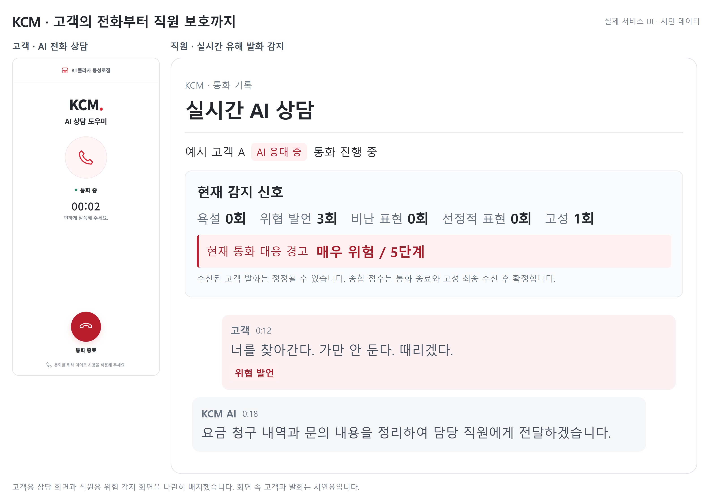

# KCM (KT Copilot Manager)

상담부터 매장 운영까지, 직원 보호 AI 에이전트
KT AX 경진대회 우수상 (2026.10) | 5인 팀 | 팀장(PM)

## 소개
KT플라자 매장 전화를 AI가 먼저 응대하고, 통화 중 유해 발화를 감지해 직원을 보호하는 AI 에이전트입니다. 음성 통화부터 상담 요약, 문자 발송, 스마트 재고 관리까지 동작하는 웹 서비스로 구현해 배포했습니다.

## 주요 기능
- 실시간 위험도 판정: 욕설, 위협·폭력, 비난·모욕·혐오, 선정성 발화와 음량 기준 고성 신호를 감지해 0~99점, 5단계로 표시
- 통화 요약: 통화 종료 후 상담 목적과 통화 내용을 OpenAI(gpt-5-mini)로 요약해 저장
- 문자 발송: 솔라피로 고객에게 안내 문자 발송
- 스마트 재고: 통화 중 재고 조회, 재고가 없으면 가까운 매장에 대여 요청 자동 전송
- 고객정보 마스킹

## 구성
| 구분 | 기술 |
|---|---|
| 웹 화면 | React, TypeScript (Vite) |
| 서버 | Node.js (SSE 실시간 전송) |
| 음성 AI 상담 | Retell AI |
| 데이터 | Supabase |
| 워크플로우 | n8n (통화 후 저장, 요약, 재고 조회) |
| 요약 | OpenAI API |
| 배포 | Render |

## 처리 흐름
1. 고객 전화를 Retell AI가 먼저 응대
2. 통화 중: Node.js 서버가 규칙으로 위험도를 계산해 SSE로 직원 화면에 실시간 표시
3. 통화 후: n8n이 통화 기록을 DB에 저장하고, OpenAI 요약 결과를 같은 기록에 반영

## 내 역할 (고근호, 팀장)
- 역할과 일정 조율, 최종 산출물 관리, 최종 발표
- 백엔드와 웹 화면을 직접 개발해 Render에 배포
- 유해 발화 판정 기준과 고객정보 마스킹 설계·구현
- 실제 통화에서 발생한 n8n 재고 조회 오류(UNSUPPORTED_SQL_SHAPE) 수정 → [수리 기록](docs/n8n-repair/README.md)

팀은 5인으로 서비스 기획, 데이터 분석, n8n 설계·연동, 영상 제작을 나눠 맡았습니다.

## 검증
`npm run check` (자동 테스트, 타입 검사, production build)와 실제 테스트 통화로 동작을 확인했습니다.

## 실행
npm install 후 환경변수를 설정하고 npm run dev로 실행합니다. 자세한 내용은 [개발 노트](docs/DEV_NOTES.md)를 참고하세요.
